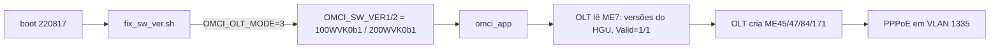

# Visão geral e causa raiz

Voltar: [[00 - Índice]]

## O problema que durou meses

Com a firmware original **V1.0-220923** e a identidade do HGU clonada, a ODI chegava a **O5** (operação), mas:

- ME45 (MAC Bridge Service Profile) e ME47 (MAC Bridge Port) ficavam **vazios**;
- PADI na VLAN 10 não recebia PADO;
- não havia Internet.

> [!warning] O5 não significa "funcionando"
> O estado O5 só diz que a ONU registrou no OLT. O serviço só existe quando o OLT cria as entidades de bridge/VLAN (ME45, ME47, ME84, ME171…).

## O que o log OMCI mostrou

Logo após o MIB Upload, o OLT enviava `StartSwDownload` / `DownloadSection` para a **Image 1**, repetidamente, e **nunca** criava a bridge. Naquele estado a ODI anunciava no ME7 (Software Image):

| | Image 0 | Image 1 |
|---|---|---|
| Version | `V1.7.1` | `V1.7.1` |
| Active / Committed | 1 / 1 | 0 / 0 |
| Valid | 1 | **0** |

Ou seja: o OLT via uma ONU com versão de software que não era a do HGU e uma imagem inválida, e ficava gerenciando software em vez de provisionar serviço.

## Causa raiz (hipótese sustentada por evidência)

O OLT só provisiona o serviço quando o ME7 da ONU parece o do HGU original. No HGU:

- Image 0: `100WVK0b1`, Active/Committed/Valid = 1
- Image 1: `200WVK0b1`, Valid = 1

A firmware 220923 **não** aplica versões customizadas ao OMCI. A **220817** inclui `/etc/scripts/fix_sw_ver.sh`, que (com `OMCI_OLT_MODE=3`) copia `sw_custom_version0/1` para `OMCI_SW_VER1/2`, antes de o `omci_app` iniciar.

> [!note] Limite da evidência
> Não foi provado *por que* o OLT decide; foi provado o antes/depois. Com `V1.7.1` + Image 1 inválida: sem provisionamento e com download de software. Com `100WVK0b1`/`200WVK0b1` e Valid=1/1: nenhuma mensagem `StartSwDownload`, `ActivateSw`, `CommitSw` ou `Reboot`, e as MEs foram criadas.

## Por que o `omci_app` importa

O binário `omci_app` da 220817 contém:

- `OnActivateSw`, `OnCommitSw`, `OnReboot` — alteram `sw_tryactive`, `sw_commit`, `sw_commit_later` e fazem `echo 1 > /proc/load_reboot`;
- no download, executa `/etc/scripts/fwu_starter.sh %d /tmp/img.tar`.

Ou seja, o OLT **consegue** gravar imagem e mandar reiniciar a ODI. Ao anunciar versões iguais às do HGU, isso deixa de acontecer. Veja [[06 - Armadilhas e troubleshooting#Reversão para outra imagem]].

## Segundo ponto: VLAN

O HGU recebe **VLAN 10** e converte para **VLAN 1335** (Extended VLAN Tagging, ME171). A ODI instalou essa regra via OMCI, mas **não a aplicou em hardware** para quadros vindos da porta LAN com VID 10. Só quadros **já marcados com 1335** passam pelo fluxo upstream. Solução: o roteador marca **1335**. Veja [[05 - Roteador e VLAN 1335]].

> [!warning] Não use VLAN 885
> Documentações de terceiros citam 885. No dump real deste HGU o mapeamento foi **10 → 1335**. Confirme no seu HGU antes de usar.
